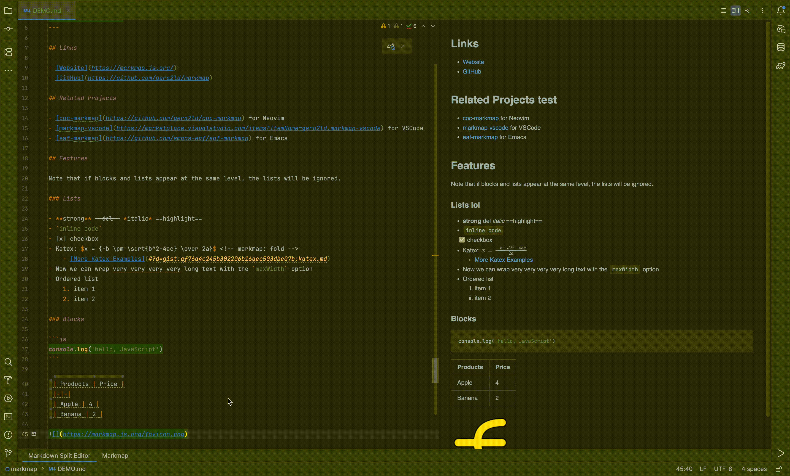

# Markmap Jet

Markmap Jet 是一款基于 [Markmap](https://markmap.js.org/) 的 JetBrains IDE 插件，可以将 Markdown 文档转换成交互式思维导图，边编辑边预览文档结构。

项目面向 IntelliJ IDEA、PyCharm 和 Android Studio 等基于 IntelliJ Platform 的 IDE。当前已在 IntelliJ IDEA Community 2024.1.7 中进行交互测试；其他 IDE 和版本的实际兼容性仍需要验证。



## 功能

- 随 Markdown 编辑实时更新思维导图，支持拖动、缩放、适应画布和展开或折叠节点。
- 支持仅编辑、分屏和仅预览模式，跟随 IDE 的明暗主题。
- 编辑器光标可同步到导图节点，双击节点可跳转到对应的 Markdown 源码。
- 支持导出 SVG 和交互式 HTML，支持配置 Markmap 默认选项与自定义 CSS。
- 支持公式、代码高亮以及 Markdown 文件目录内的相对图片和链接。
- 内置 Markmap、D3、KaTeX 等资源，基本预览无需 CDN 网络连接；外部链接和在线图片仍需要网络。

## 安装

目前可以从源码构建插件 ZIP，然后在 IDE 中选择 **Settings/Preferences → Plugins → ⚙ → Install Plugin from Disk...**，选中 ZIP 并按提示重启 IDE。构建产物位于 `build/distributions/`。

## 使用

1. 打开 Markdown 文件，在编辑器底部选择 **Markmap** 标签。
2. 使用工具栏切换编辑、分屏或预览模式，拖动和缩放导图。
3. 使用工具栏导出或打开 Markmap Settings；双击节点可跳转到对应源码。

编辑器中可使用 `Alt+Shift+T` 切换当前节点的折叠状态，使用 `Alt+Shift+R` 递归切换。文档 YAML frontmatter 中的 `markmap` 选项可以覆盖默认配置，例如：

```yaml
---
markmap:
  maxWidth: 300
  initialExpandLevel: 2
---
```

本地相对图片和链接须位于 Markdown 文件所在目录或其子目录；绝对路径、向上遍历的路径以及指向目录外的符号链接不会被打开。导出 HTML 时，最大 10 MiB 的本地图片会被嵌入。

## 环境与构建

插件声明支持 IntelliJ Platform 2023.3（build 233）及以上版本，并依赖 IDE 的 Markdown 插件和 JCEF。声明的兼容范围不等同于所有 IDE 均已完成实测。

使用 JDK 17 构建：

```shell
./gradlew buildPlugin
```

浏览器资源已包含在仓库中。如需重新生成并运行浏览器测试：

```shell
cd tools/web-assets
npm ci
node build.mjs
CHROME_PATH="/path/to/chrome" node test.cjs
```

## 致谢

- 感谢 [mobamoh/markmap-idea](https://github.com/mobamoh/markmap-idea) 的作者和贡献者，Markmap Jet 基于该项目开发。
- 感谢 [markmap/markmap-vscode](https://github.com/markmap/markmap-vscode) 的作者和贡献者，其功能和实现为本项目提供了参考。
- 感谢 [Markmap](https://github.com/markmap/markmap) 项目及其贡献者提供思维导图工具和相关库。

## 许可证

本项目采用 [MIT 许可证](LICENSE)，保留原项目的版权声明。第三方依赖及其许可信息见 [THIRD_PARTY_LICENSES.txt](src/main/resources/markmap/vendor/THIRD_PARTY_LICENSES.txt) 和 [MARKMAP_VSCODE_LICENSE.txt](src/main/resources/markmap/vendor/MARKMAP_VSCODE_LICENSE.txt)。
